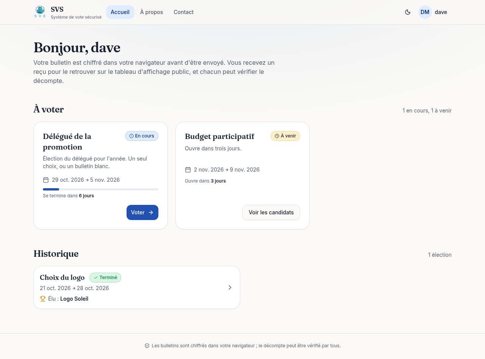
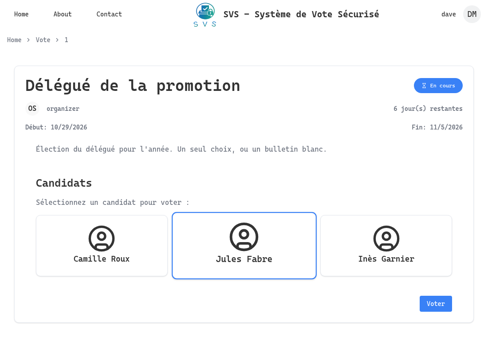
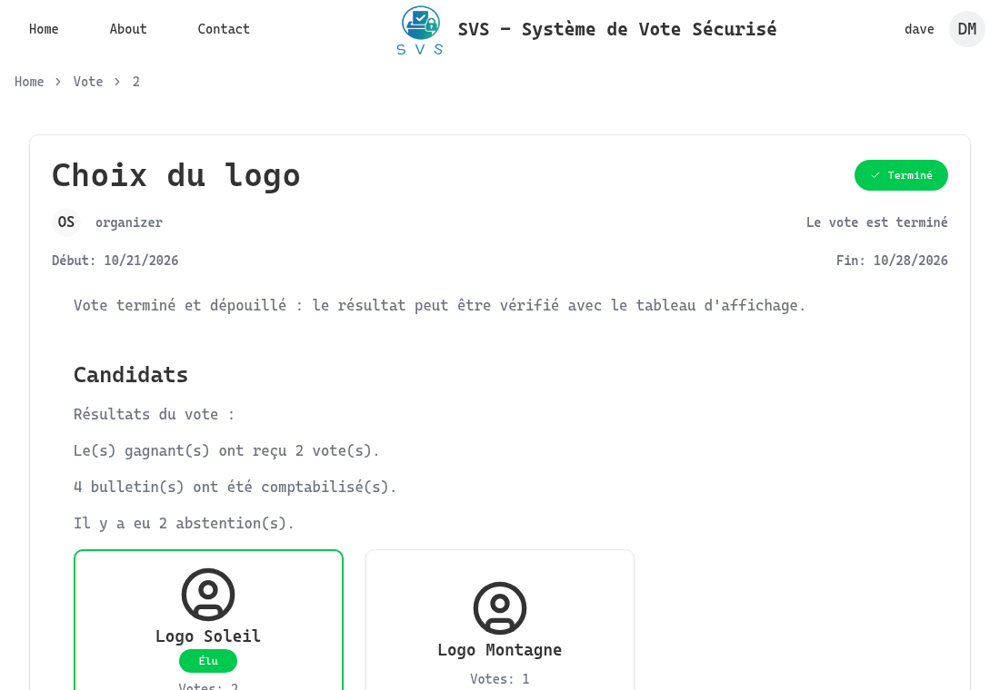
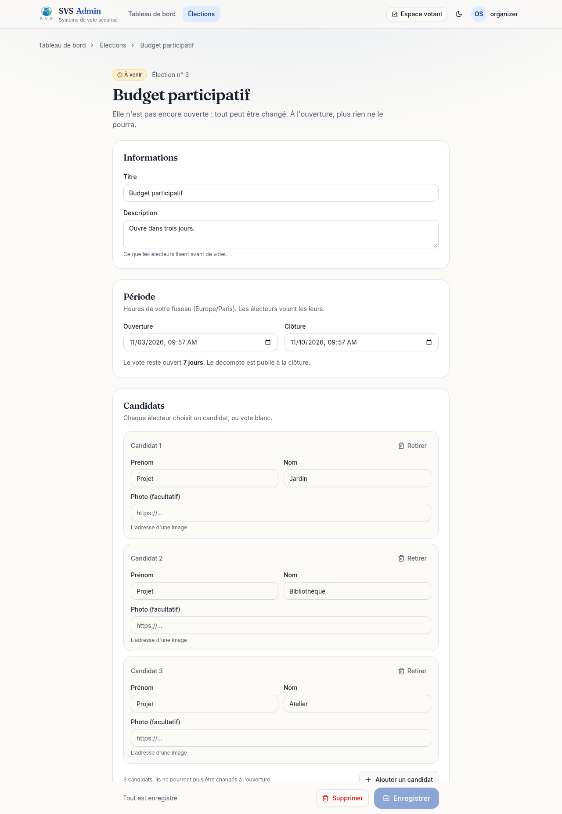
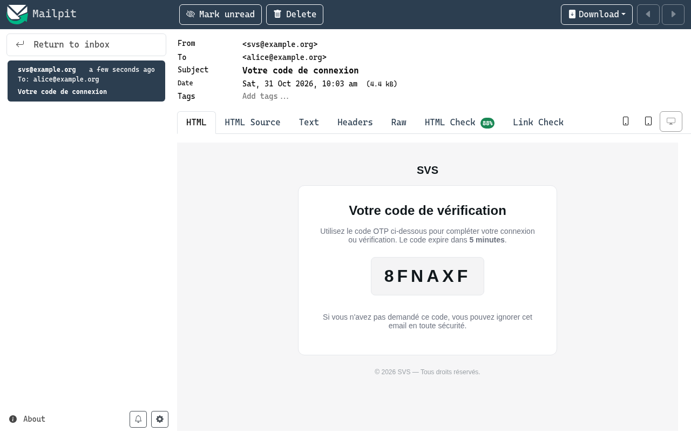

# SVS — Secure Voting System

[](https://github.com/lyesrabhi16/systeme_de_vote/actions/workflows/ci.yml)

A web application for running elections where **the ballots are encrypted in the voter's browser and counted without being decrypted one by one**, and where **anybody can check the count** from public data. Administrators create elections with their candidates and electoral rolls; people sign in with a password **and a one-time password sent by email**, vote once, receive a receipt, and see the result when the election is over. Built as the M1 "Projet Long" (Logiciels Sûrs track, Université Paris-Est Créteil). The interface is in French.

| | |
| :---: | :---: |
|  |  |
|  |  |

| | |
| :---: | :---: |
|  |  |
| *The editor of an election that has not opened* | *The email of a sign-in, in Mailpit's mailbox (demo stack)* |

## Try it

One command, no certificate and no mail server of your own: the stack brings Mailpit (needs Docker):

```bash
docker compose -f docker-compose.demo.yml up --build
```

Open <http://localhost:8000>. It starts PostgreSQL, Redis and the application, and seeds demo data: two administrators (`registrar`, who manages the accounts, and `organizer`, who manages the elections), voters (`alice`, `bob`, `carol`, `dave`, `erin`), an account with no password yet (`newcomer`), and three elections: one open, one that is over and **counted from real ballots**, one that has not opened. The password is `demo-password-123` (sign in with `alice@example.org`, …). Every sign-in sends a one-time password by email: the stack includes [Mailpit](https://mailpit.axllent.org), a mail server that keeps what it receives and delivers nothing, and **the email is in its mailbox at <http://localhost:8025>** (so are the receipts of votes and the password reset links).

Then check the count of the finished election without trusting the server:

```bash
docker compose -f docker-compose.demo.yml exec svs python -m app.utils.audit http://localhost:8000 2
# counts recomputed from the bulletin board: {4: 2, 5: 1}
# The result is verified.
```

This stack is for looking at the project (`ENV_MODE=development`, plain http); see [Deploy](#deploy) for the real thing.

## What it does

- **Two-step sign-in**: password (Argon2), then a one-time password by email (6 characters, valid 5 minutes, single use, 3 tries). An account an administrator creates without a password signs in with the one-time password alone, until its owner chooses one with the password reset by email link.
- **Two kinds of administrators**: the *inscription authority* manages accounts; the *vote authority* creates elections (dates, candidates, electoral roll), changes them until they open, and counts them. Voters see the elections they are on the roll of.
- **Voting**: a candidate or a blank ballot, a confirmation step, then the browser encrypts the choice with the election's public key and proves, in zero knowledge, that the ballot is valid. The server checks the proofs, records the ballot, marks the voter as having voted, and emails a **receipt** (the code of the bulletin on the public board).
- **Counting** when an election ends, by a scheduled job (or by the vote authority): the ciphertexts are *added*, and only the sums are decrypted.
- **Verification**: the bulletin board (every ballot, no names), the encrypted sums and a proof that each decrypts to the published count are public. [`app/utils/audit.py`](SVS-SERVER/app/utils/audit.py) checks them all from the public routes alone.
- A web client with a light and a dark theme, usable with the keyboard and on a phone (ballot choices are native radio buttons), and typed from the server's OpenAPI description. Once the vote is cast, a voter can look their receipt up on the board from the election's page.

## How it works

```text
 browser ── https ──► Traefik ──► FastAPI ──► PostgreSQL   accounts, elections, who voted, bulletins
 (React SPA,                      (uvicorn)   Redis        one-time passwords, sign-in steps, rate limits
  makes the ballot)                   └─► SMTP             one-time passwords, reset links, receipts
```

### The ballot

Each election has its own [Paillier](https://en.wikipedia.org/wiki/Paillier_cryptosystem) key pair, made when the election is created. The public key is published; the private key is kept encrypted with the server's `ENCRYPTION_KEY`. Paillier is *additively homomorphic*: multiplying ciphertexts adds the plaintexts.

A ballot is, for each candidate, an encryption of **1** (chosen) or **0**, and the browser attaches two kinds of proof, so that the server (which cannot read the ballot) can refuse a ballot that cheats:

| proof | says | without it |
| --- | --- | --- |
| one per candidate (Cramer–Damgård–Schoenmakers OR-proof, Fiat–Shamir) | this ciphertext encrypts a 0 or a 1 | a voter could encrypt 1000 for their candidate |
| one on the **product of all the ciphertexts** (which encrypts the sum) | the sum is 0 (blank) or 1 | a voter could encrypt a 1 for *every* candidate: each entry would pass its own proof |

The server verifies the whole ballot before recording anything, and a refused ballot does not use up the voter's right to vote. It also refuses a ballot with a candidate missing, repeated or unknown, and a ballot copied from the board.

### The count, and checking it

When the election is over, the server multiplies the ciphertexts of the valid ballots per candidate (the *encrypted sum*), decrypts each sum (that is the result), and publishes with it, for each candidate, the **n-th root** of `sum · g^(−count)`: it exists only if the sum really decrypts to `count`, anybody can check it with the public key, and it reveals nothing about any ballot. Anybody can then, from the public routes:

1. read the bulletin board and verify every proof of every ballot;
2. multiply the valid ones and compare with the published encrypted sums;
3. check the decryption proof of each result.

`python -m app.utils.audit <server> <election id>` does all three. A wrong count, a ballot added or removed after the fact, and a made-up proof are each caught by a test.

### The vote itself

**A session** is a JWT in an `HttpOnly`, `Secure`, `SameSite=Strict` cookie: the web client never holds it (it is not in `localStorage`, and a script injected in the page cannot read it).

**The right to vote** is taken in the transaction that records the ballot, with a single `UPDATE … WHERE user_has_voted = false`: two requests of the same voter at the same time record one ballot.

## What is and is not protected

The full model, with where each claim is tested, is in [docs/security.md](docs/security.md). In short:

### Protected, and tested

- A voter cannot vote twice (even with requests at the same time), before the opening, after the end, or without being on the roll.
- A ballot that chooses several candidates, that has an entry missing or repeated, or whose proofs do not verify is refused whole (tests make each of these ballots with a Python voter; two fixtures check that the web client and the server agree on the proofs byte for byte).
- The count can be checked by anybody; counting early is refused; counting twice gives the same result.
- The API never returns the private key of an election or the hash of a password; the candidates of an election cannot be changed once it is open (it would invalidate the ballots already cast).
- One-time passwords work once; guessing is limited per account and per address; no password, one-time password or token reaches the log.
- Production **refuses to start** with a placeholder secret, a missing key, a wildcard CORS origin or a key smaller than 2048 bits; and the error does not print the secrets it was given.
- PostgreSQL and Redis are not reachable from outside; the application runs read-only, as a non-root user.

### Not protected (read this before trusting it with a real election)

- **The operator of the server is trusted for ballot secrecy.** The private key of each election is on the server (encrypted with `ENCRYPTION_KEY`, which is on the server too), and the server knows which authenticated voter sent which ballot. Whoever controls the server can decrypt any single ballot and attribute it to a person. The design makes the *application* count without decrypting ballots one by one; it does not make the operator *unable* to. Closing that gap needs a key that is never whole on one machine (threshold decryption) and ballots not tied to an authenticated session (anonymous credentials).
- **Counting is verifiable; eligibility is not**: the audit proves that the ballots on the board are valid and are what was counted, not that each one belongs to somebody on the roll who voted. A server could add valid ballots. A voter can check that their receipt is on the board; the number of voters is published; that is all.
- A voter cannot check that the ballot made by their browser encrypts the choice they made (no "cast or audit" challenge): a compromised browser, or a modified client served by the server, could encrypt another choice.
- It is not coercion-resistant: the receipt does not reveal the choice, but nothing stops a voter from voting under the eye of somebody who will check.
- A session cannot be revoked: logging out clears the cookie, but a copied token stays valid until it expires (1 hour by default).

## Develop

```bash
nix develop        # Python 3.15, uv, bun, Docker Compose, a JRE (or install them yourself)

# the server: no PostgreSQL, Redis or mail server needed for the tests
cd SVS-SERVER
make install      # uv sync --dev, as locked in uv.lock
make test          # SQLite and an in-memory Redis
make lint          # ruff
make services      # PostgreSQL, Redis and Mailpit (the mailbox: http://localhost:8025), on this machine
cp .env.example .env   # points the application at them
make run-dev       # http://localhost:8000

# the client
cd SVS-CLIENT
bun install
bun run dev        # proxies /api to http://localhost:8000 (VITE_API_URL to change it)
bun run test
bun run lint && bun run build
```

**The API client is generated.** After a change to the API: `make openapi` (writes `SVS-SERVER/openapi.json`; a test fails if it is out of date), then `bun run generate-API-CLIENT` in `SVS-CLIENT` (needs a JRE). The generator is pinned (7.17.0).

**The proofs are made by the browser and verified by the server**, in two languages. `SVS-SERVER/app/tests/fixtures/` holds ballots made by each side (public data only), verified by the other side's tests; regenerate with `bun run interop-fixture` (in `SVS-CLIENT`) and `python app/tests/make_interop_fixture.py`.

CI ([.github/workflows/ci.yml](.github/workflows/ci.yml)) runs the lint and the tests of both parts, builds the production client, then builds the Docker image and uses it: PostgreSQL, Redis, the page, a page route, the API, and the audit of the demo election.

## Deploy

[docker-compose.yml](docker-compose.yml): the application behind Traefik with HTTPS; PostgreSQL and Redis on an internal network with nothing published; no Traefik dashboard and no access log.

```bash
cp .env.example .env              # every secret is required: the stack refuses to start without
make -C SVS-SERVER generate-certs # a local CA and a certificate for DOMAIN (or Let's Encrypt: see the comments in docker-compose.yml)
docker compose up -d --build      # https://svs-server.localhost (trust SVS-SERVER/certs/ca.crt)
```

| variable | what |
| --- | --- |
| `DOMAIN`, `HOST_URL`, `FRONTEND_URL`, `ALLOWED_ORIGINS` | where the site is. Origins are explicit: cookies are sent with the requests |
| `POSTGRES_PASSWORD`, `REDIS_PASSWORD` | the two backing services |
| `JWT_SECRET_KEY` | signs sessions (≥ 32 characters) |
| `ENCRYPTION_KEY` | a Fernet key. It encrypts the private key of every election: **back it up. Without it the elections can no longer be counted**; with it and the database, ballots can be read |
| `PAILLIER_KEY_BITS` | size of an election's key (2048 by default, the minimum in production) |
| `SMTP_*` | the mail server; required in production |

Outside production, missing secrets are made up when the process starts (and said so in the log), and without `SMTP_HOST` the emails are written to the log. To try the production stack without a real mail server, `docker compose --profile mailpit up -d` adds Mailpit (mailbox on <http://localhost:8025>, this machine only) and `.env.example` says which `SMTP_*` to set; never in production. Elections made with a made-up `ENCRYPTION_KEY` cannot be counted after a restart.

**The schema is changed by migrations** ([Alembic](SVS-SERVER/migrations/README.md)), run once per deployment by the `migrate` service (an init container on Kubernetes) before the application starts; in production the application refuses to start on a database that is behind (`python -m app.db.migrate --check`). A database made by an earlier version, with tables and no history, is *adopted*: stamped with the revision it is like, then upgraded (the ballots, tallies and proofs become `TEXT`: they outgrew their `VARCHAR`, from about 20 candidates). Back it up first, and read what it will do with `make migrate-sql from=0001`. Bulletins cast before the proof of the sum have the old format: the count leaves them out and reports them.

The Kubernetes manifest [SVS-SERVER/svs-k8s.yml](SVS-SERVER/svs-k8s.yml) uses the same image; I have not run it on a cluster.

## Repository

```text
SVS-SERVER/    FastAPI: routers, models, vote_utils (ballot checks, count), audit, crons, tests
SVS-CLIENT/    React 19, TypeScript, Vite, Tailwind, shadcn/ui; src/api/sdk is generated;
               src/services/voting makes the ballots
docs/          the security model, screenshots
Dockerfile, docker-compose.yml (deploy), docker-compose.demo.yml (try it)
```

| layer | technologies |
| --- | --- |
| Backend | Python 3.15, FastAPI, SQLModel/SQLAlchemy (async), PostgreSQL, Redis, python-paillier (`phe`), Argon2 (pwdlib), PyJWT, cryptography (Fernet), fastapi-crons, loguru |
| Frontend | React 19, TypeScript, Vite 7, Tailwind CSS 4, Radix UI, Zustand, TanStack Query/Table, Recharts, Zod, React Hook Form, paillier-bigint |
| Quality | pytest, Vitest, ruff, ESLint, GitHub Actions, Dependabot |
| Infrastructure | Docker, Docker Compose, Traefik, Kubernetes manifest, Nix |

## Roadmap

- Threshold decryption of the election key, so that nobody holds it whole, and ballots not tied to a session.
- A "cast or audit" challenge, so that a voter can check what their browser encrypted.
- Revocable sessions (a denylist in Redis), and end of all sessions after a password reset.

## License

Apache 2.0, see [LICENSE](LICENSE).
